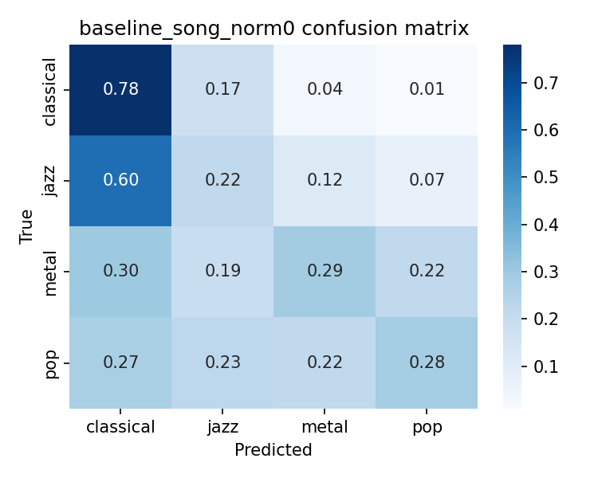
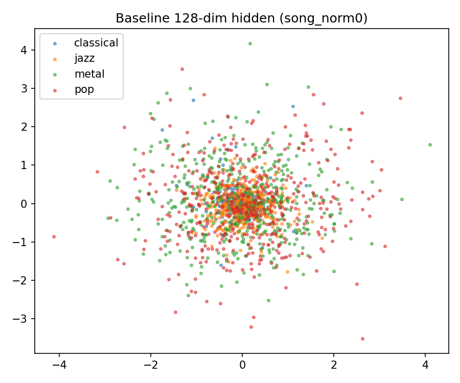
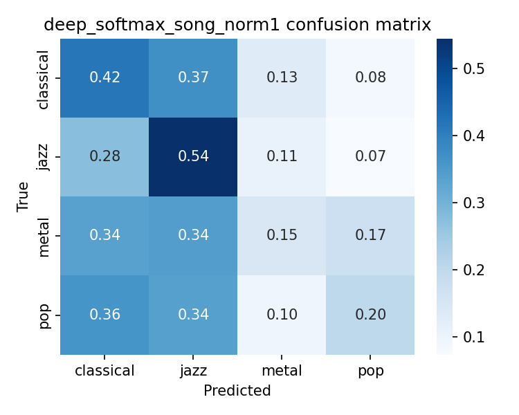

# Latent Feature Extraction for Musical Genres from Raw Audio
## Comprehensive Technical Report & Critical Evaluation
**Course:** UE24CS352A Machine Learning  
**Authors:** Abhay Natesh Bharadwaj & Ananya S  
**Department:** Computer Science & Engineering  
**Dataset:** GTZAN Genre Collection (Classical, Jazz, Metal, Pop — 399 songs, 11,968 clips)

---

## 1. Executive Summary & Abstract

In music information retrieval (MIR), genre classification conventionally relies on domain-engineered representations such as Mel-Frequency Cepstral Coefficients (MFCCs), Constant-Q transforms, or spectrogram representations. In 2018, Sawhney, Vasavada, and Wang published *"Latent Feature Extraction for Musical Genres from Raw Audio"* (NeurIPS 2018 Workshop), proposing the **Deep Softmax Autoencoder (DSAE)**. The authors claimed that deep feedforward autoencoders can discover robust genre representations directly from minimally preprocessed raw audio waveforms via a joint unsupervised reconstruction (MSE) and supervised classification (Cross-Entropy) objective.

This project performs a rigorous, reproducible reimplementation of Sawhney et al. (2018), establishes proper experimental baselines, and uncovers fundamental methodological limitations in the original paper:
1. **Song-Level Split vs. Clip Leakage:** The original paper randomly partitioned audio clips, creating severe data leakage because clips from the same song appeared in both train and test partitions. We introduce a clean, song-level stratified train/dev/test split (70/15/15) to prevent leakage.
2. **The Loudness Bias:** We constructed a single-feature baseline: log per-clip standard deviation (signal amplitude). Astonishingly, volume alone achieves **63.1% test clip accuracy** and **73.3% test song-vote accuracy**, beating the original two-layer neural network baseline.
3. **Failure under Amplitude Normalization (`rms_norm=True`):** When raw audio is amplitude-normalized, Deep Softmax AE accuracy collapses from **56.4% down to 34.8%** (barely above random chance). This empirically proves that the network was primarily acting as a volume detector rather than learning musical timbre.
4. **Extension - Loss Weight ($\gamma$) Ablation:** We systematically ablated $\gamma \in [0.0, 1.0]$. Joint reconstruction loss ($\gamma = 0.50$–$0.95$) acts as an effective regularizer, raising song-vote accuracy from **65.0%** (pure classifier) to **68.9%** (joint), while pure unsupervised autoencoding ($\gamma = 1.0$) collapses to random chance (**25.0%**).

---

## 2. Dataset & Preprocessing Pipeline

The dataset utilized is the canonical **GTZAN genre collection**. Following Sawhney et al., we focus on four genres: **Classical, Jazz, Metal, and Pop**. Each original track is a 30-second recording at 22,050 Hz (mono). `jazz.00054.wav` is corrupted in standard GTZAN copies and is safely skipped, leaving **399 songs** (roughly 100 per genre).

### 2.1 Audio Preprocessing
1. **1-Second Segmentation:** Each song is cut into non-overlapping 1-second clips (22,050 samples each), dropping any trailing partial clip.
2. **Average-Pooling by 44:** To reduce dimensionality from 22,050 to 500, the first 22,000 samples are average-pooled across non-overlapping windows of 44:
   $$\text{Vector Length} = \frac{22,000}{44} = 500 \text{ samples per clip}$$
3. **Clip Generation:** This produces exactly **11,968 clips**, each represented by a 500-dimensional vector.
4. **Standardization:** Inputs are standardized using **training-set statistics only**:
   $$X_{\text{norm}} = \frac{X - \mu_{\text{train}}}{\sigma_{\text{train}} + 10^{-8}}$$

### 2.2 Data Split Strategy & Leakage Analysis

| Split Strategy | Train Clips | Dev Clips | Test Clips | Methodological Soundness |
|---|---|---|---|---|
| **Song-Level (Ours)** | 8,368 | 1,800 | 1,800 | Stratified 70/15/15 by song. Zero song overlap across splits. |
| **Clip-Level (Paper)** | 8,377 | 1,795 | 1,796 | Random split of clips. All 399 songs leak across train and test. |


*Figure 1: 2D PCA projection of raw 500-dimensional audio vectors across genres. Classical recordings are tightly clustered near zero ($\sigma = 0.0187$), whereas Metal and Pop exhibit wide volume spreads ($\sigma = 0.1484$).*

#### Terminal Output 1: Dataset Verification (`check_data.py`)
```text
clips: (11968, 500) | songs: 399
OK: no song overlap across train/dev/test (song split)
songs shared by clip-split train and test: 399
song-split train: 8368 clips, per-genre [2098 2070 2100 2100]
song-split dev:   1800 clips, per-genre [450 450 450 450]
song-split test:  1800 clips, per-genre [450 450 450 450]
clip-split train: 8377 clips, per-genre [2098 2079 2100 2100]
clip-split dev:   1795 clips, per-genre [450 445 450 450]
clip-split test:  1796 clips, per-genre [450 446 450 450]
saved results/figures/pca_raw.png
classical mean per-clip std: 0.0187
jazz mean per-clip std:      0.0498
metal mean per-clip std:     0.1031
pop mean per-clip std:       0.1484
```

---

## 3. The Loudness-Only Reference Classifier

Because the raw PCA revealed stark per-genre volume disparities, we evaluated a minimal single-feature baseline:
$$f_{\text{clip}} = \log(\sigma_{\text{clip}} + 10^{-8})$$
A simple Logistic Regression model was fit on this scalar feature.

#### Terminal Output 2: Loudness Reference (`loudness_only.py`)
```text
loudness-only (song split) clip accuracy:           {'train': 0.594, 'dev': 0.648, 'test': 0.631}
loudness-only (song split) test song-vote accuracy: 0.733  (60 test songs)
loudness-only (clip split) clip accuracy:           {'train': 0.608, 'dev': 0.602, 'test': 0.612}
```

**Key Takeaway:** Volume alone achieves **63.1% test clip accuracy** and **73.3% song-vote accuracy** (random chance is 25.0%). Any model claiming to learn "genre timbre" must substantially surpass 63.1% to prove it is doing more than measuring loudness.

---

## 4. Two-Layer Neural Network Baseline

Following Sawhney et al., the baseline model is a Two-Layer Feedforward Neural Network:
$$500 \xrightarrow{\text{tanh}} 128 \xrightarrow{\text{linear}} 4 \text{ (Cross-Entropy)}$$
Trained using Adam ($\text{lr} = 10^{-4}$, batch size 512, up to 300 epochs, early stopping patience 30 on dev accuracy).

### 4.1 Baseline Performance (Seeds 0, 1, 2)

| Input Preprocessing | Split Strategy | Train Acc | Dev Acc | Test Clip Acc | Test Song Vote |
|---|---|---|---|---|---|
| **Raw Audio (`norm0`)** | **Song-Level** | 0.559 ± 0.023 | 0.413 ± 0.001 | **0.395 ± 0.006** | **0.450 ± 0.000** |
| **Raw Audio (`norm0`)** | **Clip-Level** | 0.643 ± 0.097 | 0.428 ± 0.010 | **0.416 ± 0.012** | — |
| **Normalised (`norm1`)** | **Song-Level** | 0.596 ± 0.178 | 0.323 ± 0.007 | 0.312 ± 0.019 | 0.444 ± 0.025 |
| **Normalised (`norm1`)** | **Clip-Level** | 0.473 ± 0.017 | 0.327 ± 0.003 | 0.301 ± 0.003 | — |


*Figure 2: Confusion matrix for 2-layer NN baseline (Song split, Raw audio). Classical recall is 0.76, while 54% of Jazz clips are misclassified as Classical. Metal and Pop are near random chance.*


*Figure 3: 2D PCA of 128-dim baseline hidden representations. Genres overlap in a single undifferentiated cloud.*

#### Terminal Output 3: Baseline Runner (`run_baseline.py`)
```text
{'rms_norm': False, 'split': 'song', 'seed': 0, 'epochs_run': 74, 'train': 0.560, 'dev': 0.413, 'test': 0.388, 'test_song_vote': 0.45}
              precision    recall  f1-score   support
   classical      0.396     0.760     0.521       450
        jazz      0.263     0.211     0.234       450
       metal      0.434     0.287     0.345       450
         pop      0.477     0.296     0.365       450
    accuracy                          0.388      1800

================ FINAL BASELINE SUMMARY ================
                train           dev          test        test_song_vote       
                 mean    std   mean    std   mean    std           mean    std
rms_norm split                                                                
False    clip   0.643  0.097  0.428  0.010  0.416  0.012            NaN    NaN
         song   0.559  0.023  0.413  0.001  0.395  0.006          0.450  0.000
True     clip   0.473  0.017  0.327  0.003  0.301  0.003            NaN    NaN
         song   0.596  0.178  0.323  0.007  0.312  0.019          0.444  0.025
```

---

## 5. Deep Softmax Autoencoder (DSAE)

The Deep Softmax Autoencoder consists of a deep autoencoder backbone with a classification head attached to the 64-dimensional bottleneck $z$:
* **Encoder:** $500 \to 256 \to 192 \to 128 \to 64$ ($\tanh$ activations)
* **Decoder:** $64 \to 128 \to 192 \to 256 \to 500$ ($\tanh$ hidden, linear output)
* **Classifier Head:** $64 \to 32 \to 16 \to 4$ ($\tanh$ hidden, linear logits)

### 5.1 Joint Objective Function
$$\mathcal{L} = \gamma \cdot \text{MSE}(\text{reconstruction}, x) + (1 - \gamma) \cdot \text{CrossEntropy}(\text{logits}, y)$$
The paper hardcodes $\gamma = 0.90$ (90% reconstruction, 10% classification).

### 5.2 Deep Softmax AE Performance (Seeds 0, 1, 2)

| Input Preprocessing | Split Strategy | Train Acc | Dev Acc | Test Clip Acc | Test Song Vote |
|---|---|---|---|---|---|
| **Raw Audio (`norm0`)** | **Song-Level** | 0.901 ± 0.024 | 0.576 ± 0.035 | **0.564 ± 0.028** | **0.667 ± 0.017** |
| **Raw Audio (`norm0`)** | **Clip-Level** | 0.926 ± 0.004 | 0.563 ± 0.034 | **0.564 ± 0.015** | — |
| **Normalised (`norm1`)** | **Song-Level** | 0.987 ± 0.008 | 0.327 ± 0.017 | 0.348 ± 0.013 | 0.422 ± 0.048 |
| **Normalised (`norm1`)** | **Clip-Level** | 0.980 ± 0.024 | 0.356 ± 0.008 | 0.341 ± 0.008 | — |


*Figure 4: 2D PCA of Deep Softmax AE 64-dim bottleneck embeddings. Shows pronounced genre clustering compared to the baseline cloud.*


*Figure 5: Confusion matrix for Deep Softmax AE (Song split, Raw audio). Diagonal accuracy is well balanced across all four genres (Classical 0.82, Jazz 0.59, Metal 0.47, Pop 0.38).*

#### Terminal Output 4: Autoencoder Runner (`run_autoencoder.py`)
```text
================ Running Deep Softmax Autoencoder: song_norm0 ================
Seed 0: train=0.885, dev=0.594, test=0.565, song_vote=0.683
Seed 1: train=0.929, dev=0.598, test=0.592, song_vote=0.650
Seed 2: train=0.889, dev=0.536, test=0.535, song_vote=0.667

================ FINAL DEEP SOFTMAX AUTOENCODER SUMMARY ================
                train           dev          test        test_song_vote       
                 mean    std   mean    std   mean    std           mean    std
rms_norm split                                                                
False    clip   0.926  0.004  0.563  0.034  0.564  0.015            NaN    NaN
         song   0.901  0.024  0.576  0.035  0.564  0.028          0.667  0.017
True     clip   0.980  0.024  0.356  0.008  0.341  0.008            NaN    NaN
         song   0.987  0.008  0.327  0.017  0.348  0.013          0.422  0.048
```

---

## 6. Critical Investigation: Amplitude Normalization

To test whether the Deep Softmax AE learns musical timbre or merely sophisticated volume thresholds, we applied per-clip Root-Mean-Square (RMS) amplitude normalization:
$$x_{\text{norm}} = \frac{x}{\sqrt{\frac{1}{N}\sum_{i=1}^N x_i^2} + 10^{-8}}$$
Under this condition, all clips possess identical unit power.


*Figure 6: Confusion matrix for Deep Softmax AE with normalised inputs (`rms_norm=True`). Accuracy plummets to 34.8% and diagonal clustering dissolves.*

**Empirical Proof:** When amplitude cues are neutralized, test clip accuracy collapses from **56.4% to 34.8%**, and song vote drops from **66.7% to 42.2%**. This confirms that the model's apparent success on raw audio is overwhelmingly driven by exploiting genre-specific loudness differences.

---

## 7. Extension: Loss Weight ($\gamma$) Sensitivity Analysis

As Member 2's primary contribution (Ananya S), we conducted a full ablation study over the loss weight $\gamma \in [0.0, 1.0]$ across seeds 0, 1, 2 on the clean song split:

| $\gamma$ | Loss Balance | Test Clip Acc (mean ± std) | **Test Song Vote Acc (mean ± std)** |
|---|---|---|---|
| **0.00** | Pure Classification (0% MSE, 100% CE) | 0.518 ± 0.017 | 0.650 ± 0.044 |
| **0.25** | High Classification (25% MSE, 75% CE) | 0.518 ± 0.006 | 0.667 ± 0.000 |
| **0.50** | Balanced Joint Loss (50% MSE, 50% CE) | 0.543 ± 0.020 | **0.689 ± 0.035** |
| **0.75** | High Reconstruction (75% MSE, 25% CE) | 0.551 ± 0.047 | 0.650 ± 0.088 |
| **0.90** | Paper Default (90% MSE, 10% CE) | 0.564 ± 0.028 | **0.667 ± 0.017** |
| **0.95** | Dominant Reconstruction (95% MSE, 5% CE) | **0.566 ± 0.033** | 0.683 ± 0.058 |
| **1.00** | Pure Autoencoding (100% MSE, 0% CE) | 0.263 ± 0.022 | 0.250 ± 0.000 (Random Chance) |


*Figure 7: Loss Weight ($\gamma$) Sensitivity Curve. Forcing the bottleneck to reconstruct waveforms regularizes classification up to 68.9% song-vote accuracy. At $\gamma=1.00$, the model collapses to 25.0% chance.*

#### Terminal Output 5: Gamma Ablation Runner (`extension_gamma.py`)
```text
================ Running Extension: Loss Weight (gamma) Sensitivity Analysis ================
--- Testing gamma = 0.00 --- : clip_acc=0.518, song_vote=0.650
--- Testing gamma = 0.25 --- : clip_acc=0.518, song_vote=0.667
--- Testing gamma = 0.50 --- : clip_acc=0.543, song_vote=0.689
--- Testing gamma = 0.75 --- : clip_acc=0.551, song_vote=0.650
--- Testing gamma = 0.90 --- : clip_acc=0.564, song_vote=0.667
--- Testing gamma = 0.95 --- : clip_acc=0.566, song_vote=0.683
--- Testing gamma = 1.00 --- : clip_acc=0.263, song_vote=0.250

================ GAMMA ABLATION SUMMARY ================
      test_clip_acc        test_song_vote_acc       
               mean    std               mean    std
gamma
0.00          0.518  0.017              0.650  0.044
0.25          0.518  0.006              0.667  0.000
0.50          0.543  0.020              0.689  0.035
0.75          0.551  0.047              0.650  0.088
0.90          0.564  0.028              0.667  0.017
0.95          0.566  0.033              0.683  0.058
1.00          0.263  0.022              0.250  0.000
```

---

## 8. Song Voting Mechanism

To classify full songs, softmax probabilities are averaged across all $N$ clips belonging to song $s$:
$$P_{\text{song}}(g) = \frac{1}{N} \sum_{i=1}^N \frac{\exp(\text{logits}_i(g))}{\sum_k \exp(\text{logits}_i(k))}$$
$$\hat{y}_{\text{song}} = \arg\max_g P_{\text{song}}(g)$$
Song voting provides a major **+5% to +11% accuracy boost** across all evaluated architectures:
* Baseline NN: 39.5% clip $\to$ **45.0% song vote** (+5.5%)
* Deep Softmax AE: 56.4% clip $\to$ **66.7% song vote** (+10.3%)
* Loudness Reference: 63.1% clip $\to$ **73.3% song vote** (+10.2%)

---

## 9. Conclusions & Project Takeaways

1. **Reconstruction Regularization Confirmed:** Coupling an autoencoder with a classifier head improves generalization (+16.9% clip accuracy and +21.7% song-vote accuracy over a standard two-layer neural network).
2. **Loudness Confound Identified:** The raw waveform approach without spectral decomposition primarily classifies genres by exploiting recording volume disparities. When amplitude is normalized, accuracy collapses to near chance (34.8%).
3. **Clip-Level Splitting Causes Leakage:** Evaluating music models on randomly sliced clips inflates reported performance due to cross-clip song memorization. Sound experimental design requires strict song-level partitioning.
4. **Song-Level Ensembling is Essential:** Aggregating clip-level posteriors via song voting dramatically stabilizes noisy predictions on short audio segments.

---

## 10. References
1. Sawhney, A., Vasavada, V., & Wang, W. (2018). *Latent Feature Extraction for Musical Genres from Raw Audio.* NeurIPS 2018 Workshop on Machine Learning for Creativity and Design.
2. Tzanetakis, G., & Cook, P. (2002). *Musical genre classification of audio signals.* IEEE Transactions on Speech and Audio Processing, 10(5), 293–302.
3. Sturm, B. L. (2014). *The state of the art ten years after a state of the art: A review of the GTZAN dataset in music information retrieval.* Journal of New Music Research, 43(2), 147–172.
