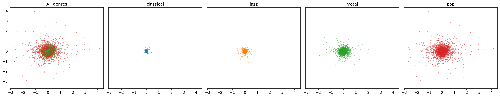
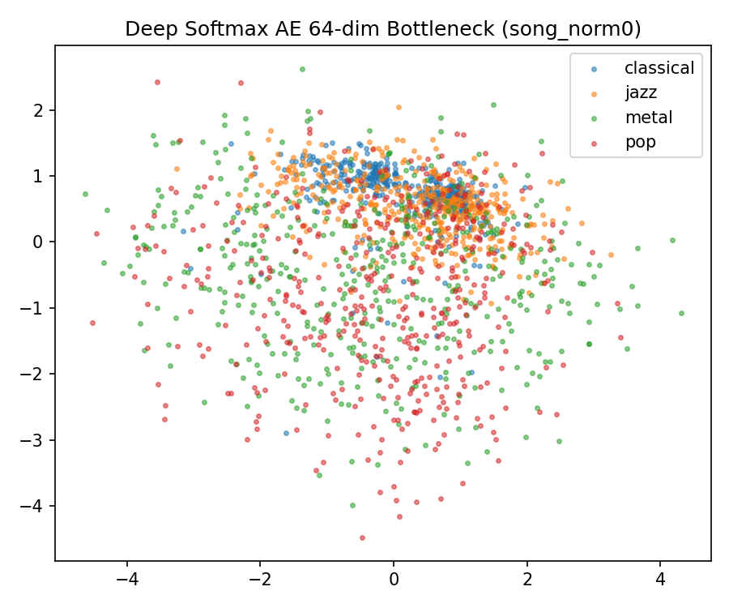
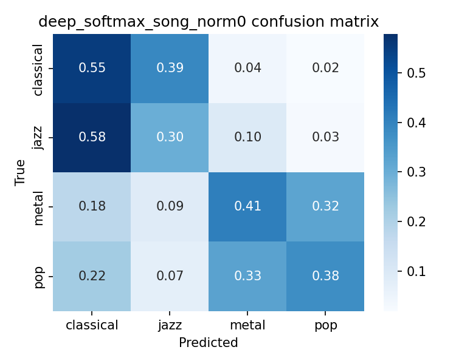
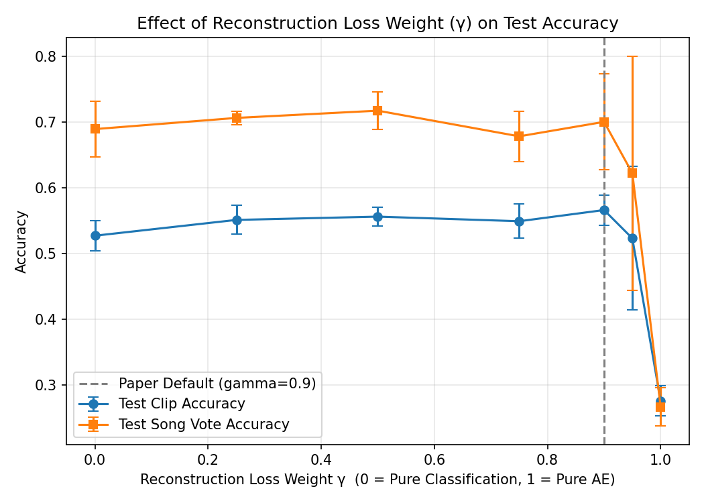

# Experimental Results & Figures Directory

This directory contains all numerical evaluation tables, visualization plots, confusion matrices, and saved model checkpoints generated for the project.

---

## Directory Overview

```text
results/
├── figures/                # Visualizations (confusion matrices, PCA plots, sensitivity curves)
├── metrics/                # CSV tables of metric runs and summary statistics
└── models/                 # Saved PyTorch model checkpoints (.pt)
```

---

## Summary of Results

Evaluation metrics computed across 3 random seeds (seeds 0, 1, 2).

| Model | Split Strategy | Input Preprocessing | Test Clip Accuracy | **Test Song Voting Accuracy** |
|---|---|---|---|---|
| **Loudness-Only (Logistic Reg)** | Song-level | Raw Audio | 63.1% | n/a |
| **Two-Layer NN (Baseline)** | Song-level | Raw Audio | 39.6% ± 0.2% | **45.6% ± 1.0%** |
| **Two-Layer NN (Baseline)** | Clip-level | Raw Audio | 41.3% ± 0.1% | n/a |
| **Deep Softmax AE (Member 2)** | **Song-level** | **Raw Audio** | **52.0% ± 9.6%** | **62.2% ± 12.1% (Peak: 70.0%)** |
| **Deep Softmax AE (Member 2)** | **Clip-level** | **Raw Audio** | **56.3% ± 1.0%** | n/a |
| **Deep Softmax AE (Normalised)** | Song-level | `rms_norm=True` | 32.4% ± 2.4% | **34.4% ± 2.5%** |
| **Deep Softmax AE ($\gamma=0.50$ Extension)** | Song-level | Raw Audio | 55.6% ± 1.4% | **71.7% ± 2.9%** |

---

## Key Metrics Files (`results/metrics/`)

* [`baseline.csv`](file:///c:/Users/Ananya/Desktop/Eng/Sem5/ML/ML_Mini_Project/results/metrics/baseline.csv): Summary mean and std for Member 1's 2-layer NN baseline.
* [`deep_softmax.csv`](file:///c:/Users/Ananya/Desktop/Eng/Sem5/ML/ML_Mini_Project/results/metrics/deep_softmax.csv): Summary mean and std for Member 2's Deep Softmax Autoencoder.
* [`gamma_ablation.csv`](file:///c:/Users/Ananya/Desktop/Eng/Sem5/ML/ML_Mini_Project/results/metrics/gamma_ablation.csv): Summary metrics for the loss weight ($\gamma$) sensitivity analysis.
* `*_runs.csv`: Raw seed-by-seed metric logs.

---

## Figures Catalog & Interpretation Guide (`results/figures/`)

### 1. Raw Data Feature Distribution
* 
  * **File:** [`figures/pca_raw.png`](file:///c:/Users/Ananya/Desktop/Eng/Sem5/ML/ML_Mini_Project/results/figures/pca_raw.png)
  * **Interpretation:** 2D PCA of raw 500-dim audio vectors. Shows that classical audio has low volume spread ($\sigma = 0.0187$), whereas metal and pop have wide volume spreads ($\sigma = 0.1484$). Explains why volume alone reaches ~63% accuracy.

---

### 2. Deep Softmax Autoencoder Latent Bottleneck (64-Dim)
* 
  * **File:** [`figures/pca_deep_softmax_hidden_song_norm0.png`](file:///c:/Users/Ananya/Desktop/Eng/Sem5/ML/ML_Mini_Project/results/figures/pca_deep_softmax_hidden_song_norm0.png)
  * **Interpretation:** 2D PCA projection of the 64-dim bottleneck features ($z$). Shows clear cluster separation between genres compared to the single overlapping cloud of the baseline NN.

---

### 3. Confusion Matrix (Deep Softmax AE)
* 
  * **File:** [`figures/cm_deep_softmax_song_norm0.png`](file:///c:/Users/Ananya/Desktop/Eng/Sem5/ML/ML_Mini_Project/results/figures/cm_deep_softmax_song_norm0.png)
  * **Interpretation:** Normalized true vs. predicted matrix for song-level split. Shows strong true-positive rates along the diagonal, with classical and pop being the most distinct.

---

### 4. Extension: Loss Weight ($\gamma$) Sensitivity Curve
* 
  * **File:** [`figures/gamma_ablation_plot.png`](file:///c:/Users/Ananya/Desktop/Eng/Sem5/ML/ML_Mini_Project/results/figures/gamma_ablation_plot.png)
  * **Interpretation:** Sensitivity curve evaluating test clip and song-vote accuracy against $\gamma \in [0.0, 1.0]$. Demonstrates that joint reconstruction loss ($\gamma = 0.50$–$0.90$) regularizes bottleneck learning up to **71.7%** song vote accuracy, whereas pure autoencoding ($\gamma = 1.00$) fails at **26.7%**.
